# ae_727 — public schema

```mermaid
erDiagram
    binder {
        uuid id PK "default: gen_random_uuid()"
        character_varying(50) user_id FK "not null"
        character_varying(255) name "not null"
    }
    card {
        character_varying(6) set_code PK, FK
        character_varying(10) collector_number PK
        character_varying(2) language_code PK
        character_varying(255) name "not null"
        character_varying(1) rarity "not null"
        uuid scryfall_id "not null"
        integer cardmarket_id
        character_varying(32) image_source
        boolean image_has_back "not null, default: false"
    }
    card_import {
        uuid id PK
        character_varying(50) user_id FK, UK "not null"
        text status "not null"
        integer source_lines "not null, default: 0"
        integer total_lines "not null, default: 0"
        integer processed_lines "not null, default: 0"
        jsonb line_errors "not null, default: '[]'::jsonb"
        integer line_error_count "not null, default: 0"
        text error_message
        timestamp_with_time_zone created_at "not null, default: now()"
        timestamp_with_time_zone finished_at
        text error_code
    }
    cardmarket_price {
        integer id_produit PK
        date date PK
        integer low
        integer trend
        integer avg
        integer low_foil
        integer trend_foil
        integer avg_foil
    }
    catalog_card {
        character_varying(6) set_code PK, FK
        character_varying(10) collector_number PK
        character_varying(1) rarity "not null"
        character_varying(255) name "not null"
        character_varying(255) french_name
        uuid scryfall_id "not null"
        integer cardmarket_id
        text image_url
    }
    collection_entry {
        character_varying(6) set_code FK "not null"
        character_varying(10) collector_number FK "not null"
        character_varying(2) language_code FK "not null"
        boolean foil "not null"
        character_varying(50) user_id FK "not null"
        integer quantity "not null"
        integer purchase_price
        timestamp_with_time_zone added_at
        uuid binder_id FK
        uuid id PK "default: gen_random_uuid()"
    }
    collection_price_history {
        date date PK
        character_varying(50) user_id PK
        integer low "not null"
        integer trend "not null"
        integer avg "not null"
    }
    collection_rarity_filters {
        character_varying(50) user_id PK, FK
        character_varying(1) rarity PK
        boolean is_open "not null, default: false"
        smallint kept_copies "not null, default: 0"
    }
    mv_card_prices {
        character_varying(6) set_code
        character_varying(10) collector_number
        character_varying(2) language_code
        boolean foil
        character_varying(255) name
        character_varying(1) rarity
        uuid scryfall_id
        character_varying(50) user_id
        integer quantity
        integer purchase_price
        timestamp_with_time_zone added_at
        integer low
        integer trend
        integer avg
    }
    mv_last_cardmarket_prices {
        character_varying(6) set_code
        character_varying(10) collector_number
        boolean foil
        integer low
        integer trend
        integer avg
    }
    purchase {
        uuid id PK "default: gen_random_uuid()"
        character_varying(50) user_id FK "not null"
        character_varying(20) kind "not null"
        integer amount_cents "not null"
        date purchased_on "not null"
        timestamp_with_time_zone created_at "not null, default: now()"
        character_varying(30) product_type
        character_varying(6) set_code FK
        text name
    }
    purchase_content {
        uuid purchase_id PK, FK
        character_varying(6) set_code PK, FK
        character_varying(10) collector_number PK, FK
        character_varying(2) language_code PK, FK
        boolean foil PK
        integer quantity "not null"
    }
    set_name {
        character_varying(6) set_code PK
        character_varying(255) name "not null"
    }
    trade {
        uuid id PK
        character_varying(50) initiator_user_id FK "not null"
        character_varying(50) respondent_user_id FK "not null"
        character_varying(20) status "not null"
        integer initiator_amount_due
        integer respondent_amount_due
        timestamp_with_time_zone created_at "not null, default: now()"
        timestamp_with_time_zone updated_at "not null, default: now()"
        timestamp_with_time_zone initiator_accepted_at
        timestamp_with_time_zone respondent_accepted_at
        timestamp_with_time_zone initiator_confirmed_at
        timestamp_with_time_zone respondent_confirmed_at
        smallint initiator_rating
        smallint respondent_rating
        timestamp_with_time_zone initiator_abandoned_at
        timestamp_with_time_zone respondent_abandoned_at
    }
    trade_card {
        uuid trade_id PK, FK
        character_varying(6) set_code PK, FK
        character_varying(10) collector_number PK, FK
        character_varying(2) language_code PK, FK
        boolean foil PK
        character_varying(50) owner_user_id PK, FK
        integer quantity "not null"
    }
    trading_binders {
        uuid binder_id PK, FK
    }
    users {
        character_varying(50) id PK
        character_varying(100) username UK "not null"
        character_varying(10) visibility "not null, default: 'private'::character varying"
        text image_url
        uuid receiving_binder_id FK
    }
    v_tradable_entry {
        character_varying(50) user_id
        character_varying(6) set_code
        character_varying(10) collector_number
        character_varying(2) language_code
        boolean foil
        integer proposed_quantity
    }
    users ||--o{ binder : "user_id"
    set_name ||--o{ card : "set_code"
    users ||--o| card_import : "user_id"
    set_name ||--o{ catalog_card : "set_code"
    binder |o--o{ collection_entry : "binder_id"
    card ||--o{ collection_entry : "set_code, collector_number, language_code"
    users ||--o{ collection_entry : "user_id"
    users ||--o{ collection_rarity_filters : "user_id"
    set_name |o--o{ purchase : "set_code"
    users ||--o{ purchase : "user_id"
    purchase ||--o{ purchase_content : "purchase_id"
    card ||--o{ purchase_content : "set_code, collector_number, language_code"
    users ||--o{ trade : "initiator_user_id"
    users ||--o{ trade : "respondent_user_id"
    card ||--o{ trade_card : "set_code, collector_number, language_code"
    users ||--o{ trade_card : "owner_user_id"
    trade ||--o{ trade_card : "trade_id"
    binder ||--o{ trading_binders : "binder_id"
    binder |o--o{ users : "receiving_binder_id"
```

## Views

- `mv_card_prices` (materialized view)
- `mv_last_cardmarket_prices` (materialized view)
- `v_tradable_entry` (view)

## Indexes and constraints

### binder

- unique index `binder_user_name_uk` (`user_id`, `name`)
- unique constraint `binder_user_name_uk` (`user_id`, `name`)
- check constraint `binder_name_trimmed`: `CHECK ((((name)::text = btrim((name)::text)) AND ((name)::text <> ''::text)))`

### card

- check constraint `card_image_back_needs_source_check`: `CHECK (((image_source IS NOT NULL) OR (NOT image_has_back)))`
- check constraint `card_image_source_check`: `CHECK (((image_source)::text = ANY ((ARRAY['gatherer_localized'::character varying, 'gatherer_en'::character varying, 'scryfall'::character varying])::text[])))`

### card_import

- unique index `card_import_one_active_per_user` (`user_id`)
- index `card_import_user_created_at` (`user_id`, `created_at`)
- check constraint `card_import_status_check`: `CHECK ((status = ANY (ARRAY['pending'::text, 'running'::text, 'completed'::text, 'failed'::text])))`

### catalog_card

- index `idx_catalog_card_french_name_trgm` (`french_name`)
- index `idx_catalog_card_name_trgm` (`name`)

### collection_entry

- unique index `collection_entry_uk` (`set_code`, `collector_number`, `language_code`, `foil`, `user_id`, `binder_id`)
- unique constraint `collection_entry_uk` (`set_code`, `collector_number`, `language_code`, `foil`, `user_id`, `binder_id`)

### collection_rarity_filters

- check constraint `collection_rarity_filters_kept_copies_check`: `CHECK (((kept_copies >= 0) AND (kept_copies <= 4)))`
- check constraint `collection_rarity_filters_rarity_check`: `CHECK (((rarity)::text = ANY ((ARRAY['C'::character varying, 'U'::character varying, 'R'::character varying, 'M'::character varying, 'S'::character varying])::text[])))`

### mv_card_prices

- index `idx_mv_card_prices_name_trgm` (`name`)
- unique index `mv_card_prices_unique` (`set_code`, `collector_number`, `language_code`, `foil`, `user_id`)

### mv_last_cardmarket_prices

- unique index `mv_last_cardmarket_prices_unique` (`set_code`, `collector_number`, `foil`)

### purchase

- index `purchase_user_date_idx` (`user_id`, `purchased_on`, `created_at`)
- check constraint `purchase_amount_positive`: `CHECK ((amount_cents > 0))`
- check constraint `purchase_kind_check`: `CHECK (((kind)::text = ANY ((ARRAY['sealed_product'::character varying, 'single_card'::character varying])::text[])))`
- check constraint `purchase_name_trimmed`: `CHECK (((name IS NULL) OR ((name = btrim(name)) AND (name <> ''::text))))`
- check constraint `purchase_product_type_check`: `CHECK (((product_type)::text = ANY ((ARRAY['BOOSTER'::character varying, 'DISPLAY'::character varying, 'BUNDLE'::character varying, 'PRERELEASE_PACK'::character varying, 'PRECONSTRUCTED_DECK'::character varying])::text[])))`
- check constraint `purchase_sealed_product_check`: `CHECK (((((kind)::text = 'sealed_product'::text) AND (product_type IS NOT NULL) AND (set_code IS NOT NULL)) OR (((kind)::text = 'single_card'::text) AND (product_type IS NULL) AND (set_code IS NULL) AND (name IS NULL))))`

### purchase_content

- check constraint `purchase_content_quantity_check`: `CHECK ((quantity > 0))`

### trade

- unique index `trade_one_active_per_pair` (expression)
- check constraint `trade_initiator_rating_check`: `CHECK (((initiator_rating >= 0) AND (initiator_rating <= 5)))`
- check constraint `trade_respondent_rating_check`: `CHECK (((respondent_rating >= 0) AND (respondent_rating <= 5)))`

### trade_card

- index `trade_card_card_owner_idx` (`set_code`, `collector_number`, `language_code`, `foil`, `owner_user_id`)

### users

- index `idx_users_username_trgm` (expression)
- unique index `users_username_unique` (`username`)
- unique constraint `users_username_unique` (`username`)
- check constraint `users_visibility_check`: `CHECK (((visibility)::text = ANY ((ARRAY['public'::character varying, 'trade'::character varying, 'private'::character varying])::text[])))`
